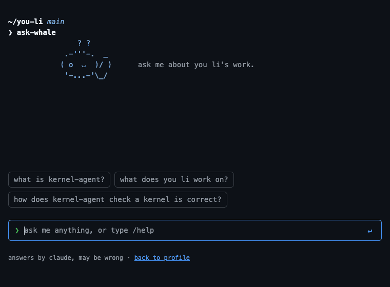

# ask-whale

a little whale for your github profile that answers questions about your work. it reads your public repos (readmes *and* code), answers in a few sentences, and cites the file and lines it got the answer from.



**try mine:** https://ask-whale.ask-whale.workers.dev

## get your own whale in three steps

you'll need a free [cloudflare](https://dash.cloudflare.com/sign-up) account and a claude api key from [console.anthropic.com](https://console.anthropic.com).

1. **clone it**
   ```sh
   git clone https://github.com/LiYou22/ask-whale && cd ask-whale && npx pnpm@10 install
   ```
2. **run setup.** it asks for your github username, logs you into cloudflare, creates the turnstile bot check, asks for your claude key, and deploys.
   ```sh
   npx pnpm@10 run setup    # `run` matters: plain `pnpm setup` is a pnpm builtin
   ```
3. **paste the badge** it prints into your profile readme. that's it.

<details>
<summary>or use the deploy button</summary>

[](https://deploy.workers.cloudflare.com/?url=https://github.com/LiYou22/ask-whale)

cloudflare copies this repo into your github and deploys it. it asks for `ANTHROPIC_API_KEY` and `TURNSTILE_SECRET` on the way. afterwards, in your copy:

1. in the cloudflare dashboard → turnstile, add a widget (mode: managed) for your worker's `*.workers.dev` hostname. its secret is `TURNSTILE_SECRET`.
2. edit `whale.config.json`: your github username, name, and the widget's site key. it still describes me until you do.
3. push. cloudflare redeploys.

`pnpm run setup` does all of this for you, which is why it's the recommended path.
</details>

## put it on your profile

the worker serves the badge itself, so there's nothing to copy into your profile repo:

```html
<a href="https://YOUR-WHALE.workers.dev"><picture><source media="(prefers-color-scheme: dark)" srcset="https://YOUR-WHALE.workers.dev/badge-dark.svg"></picture></a>
```

`setup` prints this with your real address filled in.

## make it yours

everything personal lives in two files:

| file | what |
|---|---|
| `whale.config.json` | github username, name, contact link, featured projects for `/projects`, example questions, caption, repos to skip, turnstile site key, and optionally your own ascii mascot (`mascot.art`, `mascot.moods`) |
| `knowledge/about.md` | a few public lines about you. **anything here can be quoted to any visitor** |

the whale also reads the readme of every public, non-fork repo you own, and can open their files when a question needs code.

## what it costs

| | |
|---|---|
| a question answered from readmes | ~$0.01 |
| a question that reads code (measured) | ~$0.03 |
| default limits | 20 questions per person per day, 100 total per day |
| worst case at the default limits | ~$100/month |
| cloudflare (workers, durable objects, turnstile) | free tier |

model is claude sonnet 5.5 at low effort; change `MODEL` and the limits in `wrangler.toml`. **set a monthly spend limit on your anthropic console organization**; that's the real cap. on a claude max plan, the monthly api credit can cover it.

## how it stays safe

- **public repos only.** private repos never make it into the file list, and the whale can only open files on that list.
- **signed history.** tampered chat history gets rejected.
- **rate limited.** a bot check on every question, plus daily caps per person and overall.
- **safe rendering.** answers can't inject html or images.
- **no chat logs.** questions go to the claude api, but the worker keeps nothing.

## keep it fresh

knowledge is a snapshot from the last deploy. `.github/workflows/refresh.yml` redeploys daily and on every push once you add two repository secrets:

- `CLOUDFLARE_API_TOKEN`: dashboard → my profile → api tokens → "edit cloudflare workers" template
- `CLOUDFLARE_ACCOUNT_ID`: dashboard → workers & pages, right sidebar

## develop

```sh
cp .dev.vars.example .dev.vars     # add a claude key; turnstile test key is in there
npx pnpm@10 run dev
npx pnpm@10 run deploy:fast        # page/prompt changes only, skips the github fetch
```
